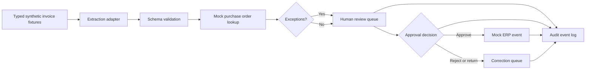

# HTL Workflow Lab — flagship engineering proof (concept specification)

**Status:** Proposed internal prototype. Selected for exploration following the company's authorization to choose the strongest demo direction; **not yet built, approved for public release, or a client case study**.

## Why this demonstration

Hope Theory Labs is positioning as a full-service AI/software engineering company: custom web/mobile software, forward-deployed engineering, AI integration, automation and enterprise data systems. An isolated chatbot is a weak demonstration of that breadth.

**Chosen vertical slice:** supplier invoice intake → field extraction → validation against orders → exception detection → human approval → audit log → simulated ERP/finance event.

This shows application engineering, structured data, AI where genuinely useful, systems integration, human governance and operational delivery. It can be built with synthetic data and free/local development tools.

### Market context (external benchmarks, not HTL performance)

- [McKinsey, State of AI 2026](https://www.mckinsey.com/capabilities/quantumblack/our-insights/the-state-of-ai): broad adoption has not translated into equally broad enterprise-scale outcomes; workflow redesign and measurement are important.
- [AWS/Ricoh, March 2026](https://aws.amazon.com/blogs/machine-learning/how-ricoh-built-a-scalable-intelligent-document-processing-solution-on-aws/): document-processing architecture with confidence thresholds, human review and integration into downstream systems.
- [BCG, 2026 agentic enterprise operations](https://www.bcg.com/assets/2026/executive-perspectives-applied-ai-with-agentic-enterprise-operations.pdf): operational workflows often require recognition/classification, data validation and controlled actions.

No competitor's reported productivity or accuracy numbers may be attributed to Hope Theory Labs.

## The buyer-facing story

**Problem:** Employees rekey invoice information and reconcile mismatches manually, slowing approvals and losing the source trail.

**Demonstration:** An operator loads a clearly synthetic invoice; the application extracts structured fields, checks a mocked purchase-order system and flags mismatch/duplicate cases. The operator reviews the evidence and makes a final decision. The system records every step and emits a simulated integration event.

**Evidence:** Screen capture, reproducible fixture set, actual test results, architecture diagram, mock API contract, and explicit failure states. Every number comes from real demo test runs, never estimates presented as results.

## Requirements — minimum viable prototype

1. **Work queue:** Synthetic invoice list showing received, parsing, needs review, approved and rejected.
2. **Document view:** Synthetic source text and/or generated PDFs; no customer documents or real supplier identities.
3. **Typed extraction:** Fields: supplier, invoice number, PO number, invoice date, BDT amount, currency, line items. Use a schema validator and normalize dates/amounts.
4. **Provider adapter:** Clear `MockExtractionProvider` (deterministic offline) and optional `LlmExtractionProvider` behind server-only API credentials. UI labels simulated versus live AI output precisely.
5. **Validation:** Cross-check against synthetic purchase orders, detect duplicates and amount mismatches, show evidence and confidence/uncertainty. Do not invent confidence percentages.
6. **Human authorization:** Approve, reject, request correction. An uncertain or failed extraction may never auto-approve.
7. **Audit trail:** Immutable-in-app event records with timestamp, actor role, input fixture ID, old/new state and reason. A production implementation would need stronger tamper protection; don't call this production-grade without it.
8. **Mock system adapter:** Emulate CRM/ERP or accounting API calls; no real money movement, external customer systems or third-party writes.
9. **Responsive interface:** Desk, tablet and phone with keyboard, labels, focus management and reduced-motion support. Existing Instrument visual tokens may be reused.
10. **Observability:** Success/failure counts from actual fixture tests, latency per stage, redacted error events, explicit model/provider indicator.

## Scope boundaries

- No real users, customer records, credentials, payment processing, automatic bank transfer, payroll or production ERP access.
- No claims about regulated compliance. Privacy and industry obligations require a separate professional review before client deployment.
- No background AI agents performing unsupervised operational changes.
- No paid API dependencies assumed. Run in deterministic offline mode when an optional free-tier model is unavailable.
- No public claim that this prototype is a customer implementation.

## High-level architecture

## Suggested implementation

- **Repository:** Prefer a dedicated `htl-workflow-lab` demo repository so the live marketing site remains stable; link to it only after review.
- **Client:** Next.js, React, TypeScript, Instrument theme tokens; accessible responsive UI.
- **Server:** TypeScript handlers, typed schemas, explicit service interfaces, model adapter behind server-only secrets.
- **Storage:** Start with synthetic JSON fixtures and an in-memory or local SQLite event store. If a hosted database is used later, confirm quotas, migration and owner access.
- **Test fixtures:** At least 30 synthetic invoices: nominal cases, duplicates, missing mandatory fields, negative/invalid amounts, mismatched PO totals, multi-line documents, English/Bangla text samples and a malformed-document case.
- **Testing:** Unit extraction validators, mocked provider failure/fallback, state transition tests, source-grounding assertions, event log integrity, API contract tests, Playwright a11y/responsiveness and review workflow.
- **Deployment:** Local-first demonstration; optional protected preview if the owner approves. Never merge a public website case study solely because the prototype builds.

## Execution phases

### Phase 0 — Design signoff (0.5–1 day)
Confirm the exact sample workflow, data/fixtures, UI expectations and no external data usage. Approve or request adjustments.

### Phase 1 — Reproducible offline vertical slice (2–3 days)
Build typed validation, fixture set, deterministic extraction, mock orders API and audit transitions. Create tests.

### Phase 2 — Operator interface (2–3 days)
Queue, split-view document/source, mismatch comparison, approval screens, error recovery, keyboard/mobile flows.

### Phase 3 — Optional AI adapter (1–2 days)
Connect a server-side LLM if a valid free-tier key is already approved, with explicit opt-in and fallback. Measure observed outcomes against fixture ground truth; never claim fabricated accuracy.

### Phase 4 — Evidence, security and publication (1–2 days)
Actual screenshots/demo recording, architecture notes, model and limitation disclosures, and reproducible acceptance tests. Publish to the HTL website **only after** the repository owner's approval and #43 positioning release.

**Estimate:** 6–10 engineering days for an offline prototype, longer for durable hosted access and production controls.

## Acceptance criteria

- [ ] 30+ synthetic fixture records committed with provenance and expected outputs.
- [ ] Deterministic complete offline demo and tests (no API keys required).
- [ ] Human decision required before any simulated downstream event.
- [ ] State changes, source evidence and error paths are visible and testable.
- [ ] All numbers are generated by actual tests and reproducible scripts.
- [ ] No PII, real customer names or business data.
- [ ] Responsive and keyboard accessible, no unresolved serious WCAG issues.
- [ ] Independently reviewed code, screenshots and threat model.
- [ ] Clearly labeled **Internal prototype / Concept**, not client work.
- [ ] Explicit separate approval before publishing the case study on production.

Linked sprint: #77; business proof issue: #76; positioning: #43.
